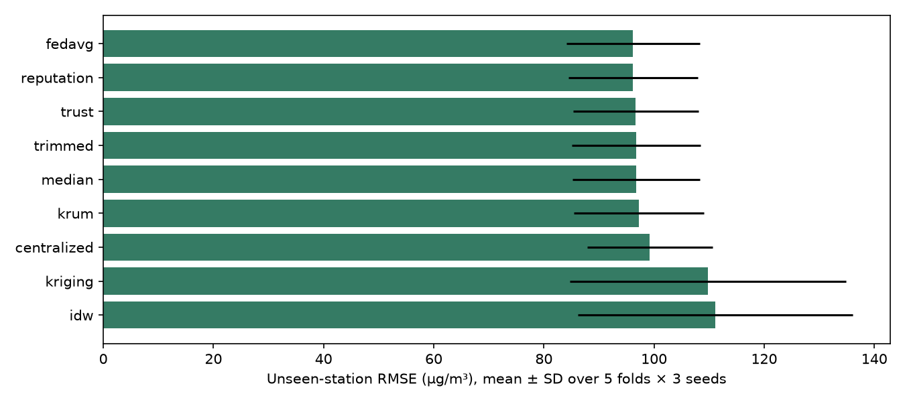
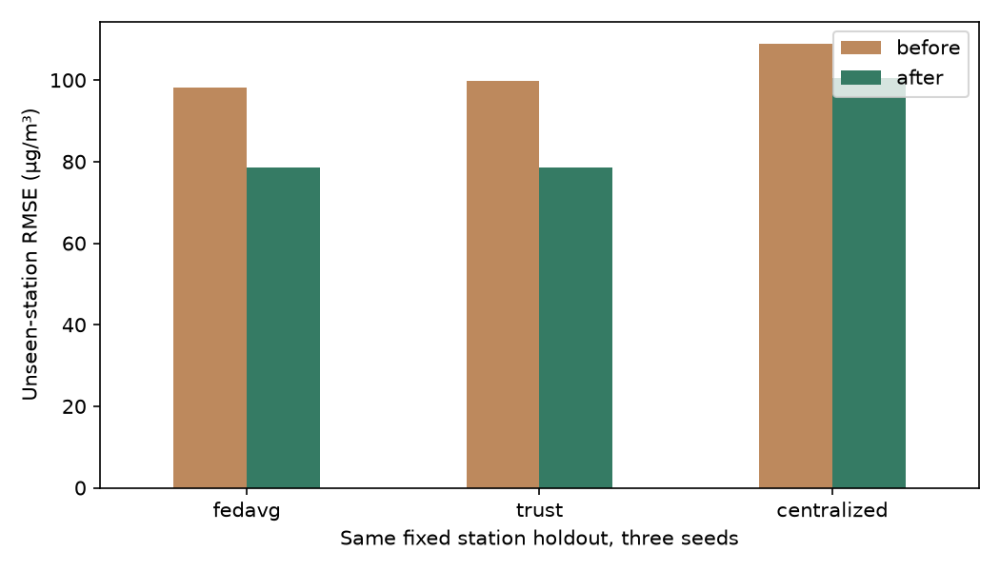

# AirTrust

**Federated Learning for City-Wide Air Pollution Mapping Without Centralizing Sensor Data**
BCSE316L · Design of Smart Cities · AY 2026–27 · Team 10 · Assigned Project 9

AirTrust is a reproducible research prototype for Delhi air-quality prediction. Eight geographic clients train spatial and temporal models on local simulated sensor readings and exchange model parameters. Its dashboard shows historical pollution maps, calibration, model comparisons, robustness, privacy probes and data quality.

**Real reference observations; simulated low-cost sensors; single-computer federation.** This is not a live deployment or a formal privacy guarantee.

## Start here for evaluation

- [Review 3 presentation — 12 slides](docs/AirTrust_Review3_Presentation.pptx) — dataset roles and counts, station map, editable architecture diagrams and result charts, simulation scenarios, and presenter notes.
- [Eight-page study and simulation guide](docs/Team10_Study_and_Demo_Guide.pdf) · [editable Word version](docs/Team10_Study_and_Demo_Guide.docx) — exact button sequence, speaking script, dataset answers and viva preparation.
- [Requirements and teacher-feedback evidence](docs/REQUIREMENTS.md)
- [Implementation report](docs/IMPLEMENTATION_REPORT.md) and [extended findings](docs/EXTENDED_EVALUATION.md)
- [Final report PDF](docs/Team10_Final_Report.pdf), [editable report](docs/Team10_Final_Report.docx) and [review slides](docs/Team10_Review_Slides.pptx)
- [25-paper literature comparison](docs/LITERATURE_REVIEW.md)
- [Dataset documentation](datasets/README.md) and [demo guide](docs/DEMO_GUIDE.md)

Saved models, results and a public-data snapshot are included. Retraining is optional.

## Quick start

Tested with Python 3.13 and CPU PyTorch on Windows. No GPU or API account is required.

```bash
git clone https://github.com/rizzit17/airtrust.git
cd airtrust
python -m venv .venv
```

Activate with `.venv\Scripts\Activate.ps1` in PowerShell, `.venv\Scripts\activate.bat` in Windows Command Prompt, or `source .venv/bin/activate` on macOS/Linux.

```bash
python -m pip install -r requirements.txt
python scripts/prepare_local_data.py
python -m uvicorn airtrust.server:app --host 127.0.0.1 --port 8000
```

Open **http://127.0.0.1:8000**. Keep the terminal running. Windows users can also run `start.bat` after setup. If the port is occupied, use `--port 8001` and open that port.

The source bundle is verified with SHA-256 before extraction. After installing dependencies and extracting data, the dashboard works offline. Generate separate submission ZIPs and processed samples with `python scripts/build_submission.py`; ZIPs are excluded from Git to avoid duplication.

## Datasets

| Source | Period | Source records | Role |
|---|---|---:|---|
| Delhi CPCB CAAQM PM2.5 via XKDR | Jan–Dec 2024, hourly IST | 317,627 | Primary reference labels for FL simulation |
| Delhi CPCB CAAQM PM10 via XKDR | Jan–Dec 2024, hourly IST | 323,061 | Contextual pollutant explorer |
| Delhi CPCB CAAQM NO₂ via XKDR | Jan–Dec 2024, hourly IST | 325,379 | Contextual pollutant explorer |
| UCI Beijing Multi-Site Air Quality | Mar 2013–Feb 2017 | 420,768 station-hour rows | Independent temporal persistence benchmark |

Delhi now contains **966,067 pollutant observations**, adding **648,440** to the original source. Including Beijing gives **1,386,835 source rows**, with different schemas: one pollutant per Delhi row versus multiple variables per Beijing station-hour. Duplicate weekly copies, nested ZIPs and synthetic derivatives are not counted again.

The PM2.5 experiment retains **300,355 valid observations at 36 distinct locations** from 39 catalog entries. Invalid values are excluded; stations need at least 70% hourly coverage; coordinates within 50 m are consolidated. Reference labels are never filled. Inputs alone are causally forward-filled for at most three hours.

**Licensing and attribution:** both sources are CC BY 4.0. Credit *India Air Quality Database, XKDR Forum*, CPCB CAAQM, and *Song Chen / UCI Machine Learning Repository*. See [XKDR documentation](https://github.com/xKDR/Air-Quality-Database), [UCI DOI](https://doi.org/10.24432/C5RK5G) and [license terms](https://creativecommons.org/licenses/by/4.0/). Cleaning, simulated errors and sample construction are our modifications. No provider endorsement is implied.

OpenAQ and sensor.community were proposal candidates but are **not used** here. Beijing is reference-grade, not low-cost sensor data; no cross-city FL claim is made. PM10/NO₂ expand contextual analysis, not PM2.5 training labels.

## Methods


- **Spatial graph model:** local donor stations' six past readings and relative coordinates predict the target hour. The target reading is not an input.
- **LSTM:** long short-term memory model using a known station's own history. It is evaluated separately from unseen-location mapping.
- **Comparators:** centralized, equal averaging, FedAvg, trust weighting, median, trimmed mean, Krum, instantaneous update consistency, temporal reputation, ordinary kriging, inverse distance weighting and persistence.
- **Trust:** training sample count × exp(−early co-location RMSE/35), confidence floored at 0.05. Each virtual sensor is compared with its own reference, avoiding nearest-station gradient confounding.
- **Training:** seeds 17, 29, 43; 20 rounds; 12 local steps; Adam 0.002; batch 128. Checkpoint selection uses validation RMSE.
- **Time:** first 10% calibration, next 60% training, next 15% validation, final 15% test. Privacy nonmembers are reserved from the training era.
- **Spatial CV:** five rotating station folds × three seeds. Every station is withheld once per seed from fitting, validation, calibration and donors. Fold-seed SD is not an independent-window confidence interval.
- **Calibration ablation:** early seen-station pairs fit a linear correction applied to later inputs and noisy labels. Reported on the original fixed holdout, separately from CV.
- **Sensor sensitivity:** engineering bias/gain/drift/dropout/stuck-read stress tests plus a separate relative-error scenario anchored to [Zheng et al. (2018)](https://doi.org/10.5194/amt-11-4823-2018). The generative distribution is our assumption, not a fitted Delhi hardware model.

## Measured findings

Five-fold unseen-station results, mean ± SD over 15 fold-seed runs:

| Method | MAE (µg/m³) | RMSE (µg/m³) | R² |
|---|---:|---:|---:|
| FedAvg | 68.20 ± 9.47 | 96.16 ± 12.11 | 0.466 ± 0.195 |
| Trust-weighted FL | 68.01 ± 8.83 | 96.69 ± 11.35 | 0.465 ± 0.172 |
| Centralized graph model | 71.20 ± 9.53 | 99.25 ± 11.35 | 0.434 ± 0.190 |
| Ordinary kriging | 80.84 ± 19.19 | 109.80 ± 25.11 | 0.241 ± 0.500 |



Trust weighting does **not** establish an advantage over FedAvg. In the separate fixed-holdout ablation, correction reduces trust-model RMSE from **99.92 ± 7.05 to 78.67 ± 2.02 µg/m³**; corrected FedAvg achieves **78.49 ± 2.05**. Input correction helps this simulation, while a trust-weighting advantage remains unproven.



The membership probe uses individual-update loss improvement under an honest-but-curious server. Near-chance AUC for this limited attack does not establish privacy. No differential privacy or secure aggregation is implemented. Communication measures logical float32 payload, not actual radio traffic, latency or energy. FL does not necessarily transmit fewer bytes than a one-time upload of this small dataset.

## Dashboard

Overview; historical prediction map and station detail; client trust and convergence; method comparisons; corruption sweep; privacy probe; dataset exports; Simulation Lab with sensor controls, early calibration, station coverage audits, PM10/NO₂ trends and station-CV results. Scenario controls compute labelled diagnostics, not silently retrained FL models.

## Reproduce

```bash
python scripts/run_experiments.py
python scripts/run_spatial_cv.py
python scripts/run_calibration.py
python scripts/run_sensitivity.py
python -m pytest -q
python scripts/build_extensions.py
python scripts/build_submission.py
python scripts/package_submission.py
python scripts/verify_submission.py
```

`reproduce.bat` runs this sequence on Windows. CPU runtime varies. Extension runners resume existing per-run files: intentionally changing a configuration requires fresh corresponding output files to avoid mixing cached results. `requirements-lock.txt` records the original environment; `requirements.txt` provides compatible ranges.

Download sources again, if desired:

```bash
python scripts/download_data.py
python scripts/expand_data.py
```

The downloader uses the provider's publicly documented demonstration key, bounded requests and truncation checks. This is not a private credential. External-service availability may change; the bundled snapshot preserves evaluated inputs.

## Repository layout

| Path | Contents |
|---|---|
| `airtrust/` | Data pipeline, models, experiments and API |
| `web/` | Offline dashboard |
| `scripts/` | Restoration/download, experiments and exports |
| `datasets/bundled/` | Public source snapshot and checksum |
| `datasets/manifest.json` | Provenance and integrity checks |
| `results/` | Models, metrics, predictions and figures |
| `results/spatial_cv/` | Five-fold audits and predictions |
| `results/calibration/` | Input-correction ablation |
| `results/sensitivity/` | Relative-error and temporal-reputation experiments |
| `docs/` | Reports, literature, requirements and demo guide |
| `tests/` | Aggregation, leakage prevention, predictions and API checks |

## Team and assessment status

| Member | Registration |
|---|---|
| Rishit Chaudhary | 23BCT0157 |
| Siddharth Verma | 23BCT0159 |
| Jashan Sahasrabudhe | 23BCT0022 |
| Adarsh Narayan | 23BCT0155 |

SDG relevance: environmental exposure monitoring (SDG 3), urban air quality (SDG 11.6), environmental observation (SDG 13). Health and climate outcomes are not measured.

Publication status: **not submitted**. The implementation and manuscript do not constitute an acceptance, submission ID, completed live presentation or guaranteed assessment score.

AI assistance was used for implementation, documentation and debugging. Figures are generated from exported observations and experiment results. The team must review the work and understand it before submission and oral examination.

Code: [MIT](LICENSE). Dataset and third-party publication rights are separate. Private grading/similarity reports and third-party publisher PDFs are not included.
