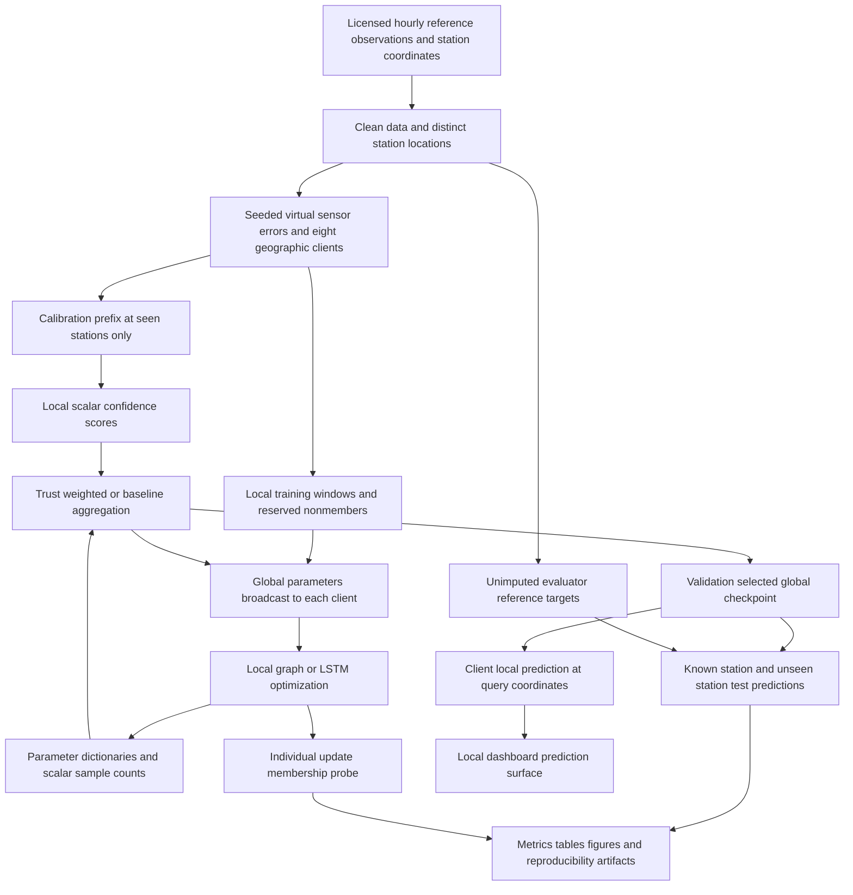

# Architecture and requirement traceability

The simulated evaluator has access to public ground truth. The aggregator's Python interface accepts parameter states and scalar weights only. This is algorithmic separation in one process; it is not a claim of independently isolated clients, encrypted transport, secure aggregation or formally private inference.

| Assigned or proposed requirement | Implementation and evidence | Boundary |
| --- | --- | --- |
| Public valid data and separate dataset submission | Original Delhi and UCI ZIP/CSV files, processed client files, CC BY credit and SHA-256 manifest | Reference readings are real; low-cost errors and ownership are simulated |
| Spatio-temporal predictor | Inductive message-passing graph, six donor hours and cyclic time features | Small star graph, not a reproduction of GraphSAGE/BGraphGRU |
| Temporal model comparison | 16-unit LSTM, same six-hour lookback, own target history | Known-station forecasting only; a different information set |
| Federated training | Eight client training loops and parameter aggregation | Single-process simulation, no physical edge devices |
| Calibration trust | Co-located virtual/reference prefix residual, confidence floor and sample-adjusted weights | Fixed synthetic error profiles, initial trust can become stale |
| Standard aggregation and alternatives | Sample-weighted FedAvg, equal averaging, median, trimmed mean, Krum, update consistency | Krum empirical use exceeds actual corruption bound in primary scenario |
| Centralized comparison | Pooled noisy examples, matched total step budget | Accuracy comparator, no guaranteed upper bound |
| Classical spatial baselines | IDW and exponential ordinary kriging | Same local donors and previous-hour timing; not citywide pooled contemporaneous interpolation |
| Held-out evaluation | Chronological calibration/train/validation/test periods plus eight excluded stations | One fixed spatial holdout, not five-fold cross-validation |
| Repeated measurements | Three seeds, mean ± sample SD, paired seed-level Wilcoxon | Limited power and no claim of independent window-level samples |
| Robustness | 0/2/3/5 corrupted clients across three seeds, four aggregators | Error severity fixed; client fraction varied |
| Privacy assessment | Individual-update loss-improvement membership ranking, random reserved same-era windows | Heuristic probe, overlapping histories, no certified privacy |
| Communication costs | Float32 parameter uploads/broadcasts, prepared raw-tensor comparator, runtime | Logical counts, excludes transport and calibration overhead |
| City map | Saved-model grid inference and actual monitor coordinates, selectable time/model | Historical PM2.5 surface; no dense-grid truth or boundary masking |
| Secondary dataset | Beijing source retained and chronological persistence benchmark | No federated cross-city generalization claim |
| Technical report | Generated implementation report, actual results, figures and disclosures | Earlier DOCX/PPTX submissions not overwritten |
| Academic publication | No fabricated venue/DOI/acceptance | Publication and a venue-format final manuscript remain separate academic work |

## Trusted information available to the experiment

The calibration scorer uses seen stations in the first 10% of the year. The checkpoint selector uses clean known-station validation targets from 70–85% of the year. The evaluator uses test truth only for scoring. All trainable methods receive the same checkpoint-selection access. No held-out station contributes a donor input, calibration residual, training label or validation target.

The nonmember reserve is removed before training. It is used only to score the membership probe. Archived NPZ samples include both learner and evaluator fields for reproducibility; the graph learner does not consume target histories or evaluator reference truth.
