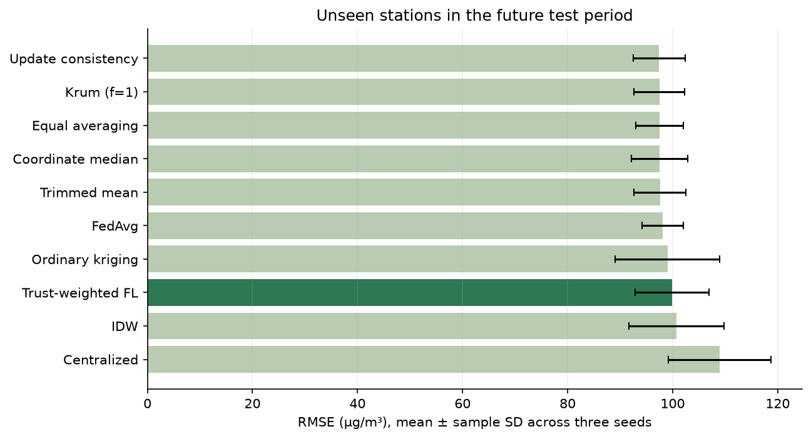
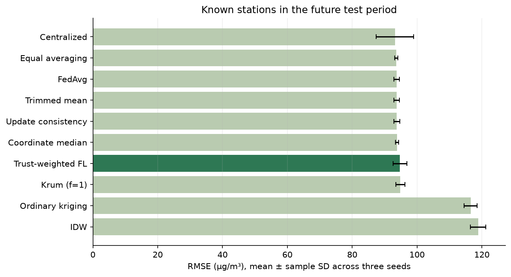
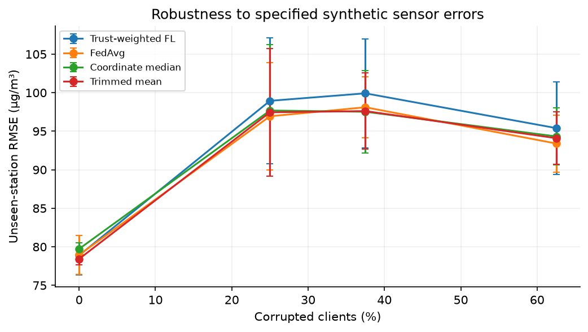
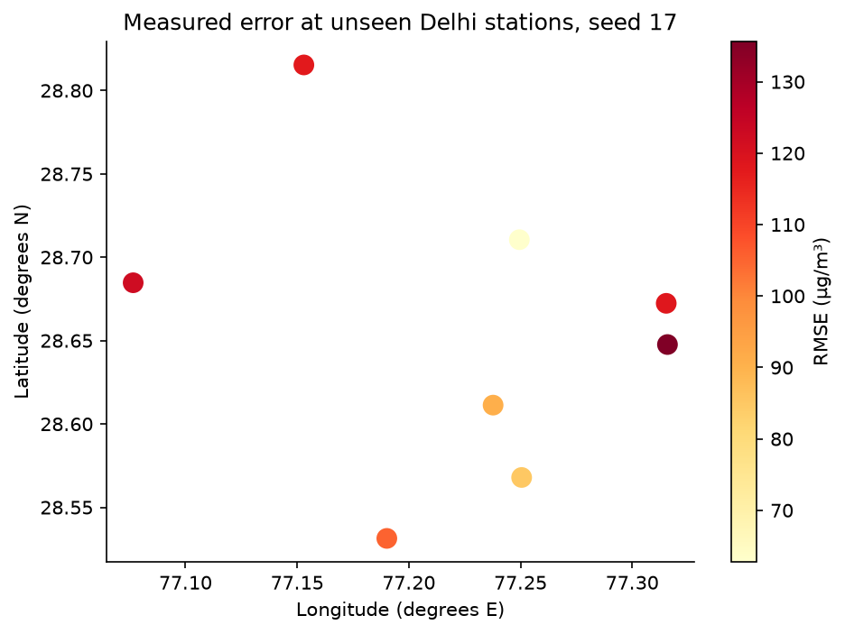
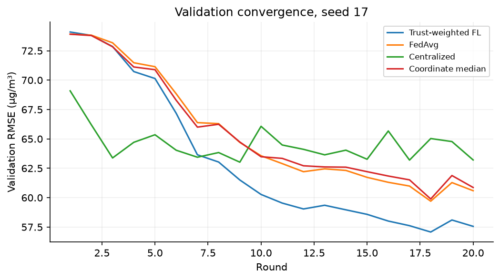
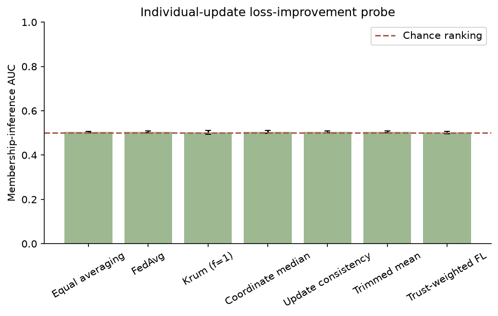

# Trust Weighted Federated Learning for City Wide Air Pollution Mapping in Delhi

BCSE316L Design of Smart Cities · Team 10 · Project 9 · AY 2026–27

Rishit Chaudhary 23BCT0157; Siddharth Verma 23BCT0159; Jashan Sahasrabudhe 23BCT0022; Adarsh Narayan 23BCT0155.

## Abstract

We implemented and evaluated a single-machine federated air-quality simulation using real hourly Delhi reference observations and explicitly simulated low-cost sensor errors. The retained network contains 36 distinct monitoring locations, partitioned into eight geographic clients; eight stations are excluded from fitting. We compare an inductive spatial graph model under eight training/aggregation strategies with ordinary kriging and inverse distance weighting, and separately test a temporal LSTM. Across seeds [17, 29, 43], trust-weighted graph FL obtained unseen-station RMSE 99.92 ± 7.05 µg/m³, compared with 98.11 ± 3.98 for FedAvg, a signed reduction of -1.85%. The best unseen-station comparator was Update consistency (graph), with RMSE 97.44 µg/m³. These measurements support only the specified simulation and split. We include a corruption sweep, logical communication accounting and an update-based membership-inference probe. No formal privacy or universal accuracy claim is made.

Keywords: federated learning; PM2.5; sensor calibration; spatial prediction; graph neural network; smart cities.

## 1 Project and implementation scope

The assigned project asks whether geographically distributed sensor owners can jointly predict city pollution while retaining raw training readings locally. Its instructor note identifies heterogeneous calibration quality and co-location-based weighting as the main experiment. Earlier submissions described a design without trained results. This implementation supplies executable models, actual predictions, data provenance, a local demonstration dashboard and reproducible measurements. All original submissions remain unchanged.

Each client trains from its own simulated sensor readings. The aggregation function accepts parameter dictionaries and scalar weights, not raw records. The simulator and evaluator necessarily load public reference data to construct the experiment and score outputs; this is not a deployment across independently protected organizations. At mapping time a local client uses its donor histories and returns a prediction. This is a simulation of local inference, not a demonstrated encrypted network protocol. The dashboard is an additional presentation interface beyond the earlier paper's scope.

## 2 Data provenance and suitability

The primary dataset is the India Air Quality Database published by XKDR Forum, sourced here from CPCB's continuous ambient monitoring network. We downloaded 317,627 hourly PM2.5 rows for 2024 from 39 source station entries, with original timestamps, units and coordinates. After excluding insufficient-coverage and co-located entries, 300,355 valid observations remain at 36 distinct locations. The compilation is licensed CC BY 4.0 and must be attributed to India Air Quality Database, XKDR Forum, together with CPCB. Source readings are preliminary; this project does not perform regulatory validation. Source: https://airquality.xkdr.org and https://github.com/xKDR/Air-Quality-Database.

The secondary dataset is Song Chen's UCI Beijing Multi-Site Air Quality dataset (DOI 10.24432/C5RK5G), licensed CC BY 4.0. The retained original archive covers 12 reference stations from March 2013 through February 2017, with 420,768 station-hour rows and pollutant/meteorology fields. We run an independent temporal persistence benchmark on it. We do not claim it contains low-cost instruments or that it establishes Delhi-to-Beijing model transfer. Source: https://archive.ics.uci.edu/dataset/501/beijing+multi+site+air+quality+data.

OpenAQ and sensor.community were considered in the proposal. They are not data sources used in the measured implementation. The selected licensed historical sources are directly downloadable and suitable for a self-contained dataset submission. Weather variables are not used in Delhi models; no unverified meteorology is fabricated. The original UCI archive includes weather fields but the secondary sanity benchmark uses PM2.5 only.

### Cleaning and organization

We align Delhi observations to the 8,784 local hours of leap year 2024. Duplicate station-hour entries are averaged. Values below zero or above 2,000 µg/m³ are removed. Stations require 70% valid coverage. Entries within 50 m of another retained entry are treated as co-located catalog entries; the more complete entry is kept to prevent them straddling training and unseen-station sets. Excluded co-located entries: ['site_1563']. Coverage filtering uses full-year availability, a benchmark-construction choice that should be revisited for prospective deployment.

Only input histories are forward-filled, with a three-hour maximum. We never backfill and never impute the reference target. A sample is excluded when its donor history or reference target is unavailable. PM2.5 inputs and labels are divided by 100; relative coordinates are expressed in kilometers and divided by 50. These fixed scaling constants do not use test statistics. Exact samples, reference data, simulated readings, station ownership and splits are exported under datasets/processed.

## 3 Simulation and experimental design

Client groups are deterministic, approximately balanced latitude-ordered geographic strips. For each client, a virtual sensor is co-located with each retained reference monitor. A seeded subset of clients receives severe synthetic errors. The primary scenario has three of eight corrupted clients (37.5%); the nominal 40% setting is rounded to whole clients.

Virtual reading = max(0, gain × reference + bias + annual_drift × elapsed_year_fraction + Gaussian_noise). Independent dropouts and stuck blocks are then applied. Parameters below are explicit scenario assumptions, not measured Plantower specifications or values attributed to an unverified paper. Relative humidity and physical aerosol growth are not modeled.

| Scenario | Bias µg/m³ | Gain | Drift over year µg/m³ | Noise SD µg/m³ | Dropout probability | Six-hour stuck blocks |
| --- | --- | --- | --- | --- | --- | --- |
| Mild | 1.5 | 1.02 | 2 | 3 | 0.01 | 0 |
| Severe | 35.0 | 1.25 | 30 | 12 | 0.04 | 12 |

Stuck-block starts are sampled uniformly after the first day; a block repeats the preceding reading. Reference missing values propagate into simulated values. Trust scores use only co-located virtual/reference pairs at training stations during the calibration period, avoiding spatial-gradient confounding.

### Chronology and spatial isolation

The first 10% of hours are calibration-only, ending 2024-02-06 14:00:00 IST. Model-training targets occupy 10–70%, validation targets 70–85%, and test targets 85–100%. Training ends 2024-09-13 04:00:00; testing starts 2024-11-07 02:00:00. Thus we reserve a separate calibration prefix rather than claiming all of the first 70% is model training. All models use six hours of strictly past history to predict the next hourly target, with samples every three hours. Input history can precede a split boundary, as it would in a rolling prediction setting; future targets never enter earlier fitting.

Eight complete stations, one per geographic client, are held out from training, validation, calibration and donor inputs. They are scored only in the future test period. This is one deterministic spatial holdout, not five-fold spatial cross-validation. Separate known-station and unseen-station tables prevent a forecasting result from being presented as unseen-location mapping evidence. The exact unseen station IDs are site_1562, site_1429, site_1425, site_301, site_1435, site_1561, site_1432, site_5024.

For membership probing, 10% of eligible training-era windows are randomly reserved as nonmembers and removed before optimization. Adjacent histories may overlap; this limitation is explicit. Seed-17 sample counts: {"train": 35463, "validation": 10081, "test": 11506, "spatial": 3254, "nonmember": 3982}.

## 4 Models and aggregation

The spatial learner is an inductive star-graph message-passing network. The target has a coordinate but no pollutant reading. Each of up to three other training stations in the same client contributes its six-hour PM2.5 history and relative x/y coordinates. A shared 8→24→16 message network, learned attention, pooled messages and four cyclic time features produce a residual correction to the weighted last donor value. When only two donors are available, the last donor is repeated to obtain a fixed three-message input; this changes its effective multiplicity and is a limitation. Neighbor order is immaterial. Target station IDs are never model inputs.

The temporal learner is a 16-unit LSTM using six hours of the target station's own history plus cyclic time features. It predicts a residual from persistence. It is evaluated only at known stations because it cannot observe a history at a location with no sensor. Its information set is richer than the graph model's target-excluding inputs, so their scores are not a controlled architecture ablation.

Trust confidence c_k = max(exp(−calibration_RMSE_k / 35), 0.05); aggregation weight alpha_k = n_k c_k / sum_j(n_j c_j). Sample-weighted FedAvg sets c_k=1. Equal averaging is implemented separately. No raw record is an argument of the aggregator.

We also implement coordinate-wise median, one-coordinate-tail trimmed mean, Krum with assumed f=1, and an update-consistency comparator (sample count divided by distance from the coordinate median update). The latter is our explicit heuristic; it is not a claimed reproduction of a published reputation algorithm. Krum's theoretical Byzantine condition for the actual corrupted-client count is violated in the primary three-of-eight scenario and the five-of-eight sweep. It remains an empirical comparator only.

Centralized models use the same noisy labels and features with pooled training. They are comparators, not guaranteed accuracy ceilings. For each round they receive eight times the per-client step budget, matching total optimization steps. All neural optimizers are Adam, learning rate 0.002, batch size at most 128, gradient clipping norm 5, 20 rounds and 12 local steps per client per round. Adam state is reset for each local training call, including each centralized round. Checkpoints are selected only by clean validation-reference RMSE at known stations; all trainable methods receive this same validation access. No hyperparameter search or test-based tuning is performed. Clean validation feedback is additional trusted information whose deployment cost is not modeled.

IDW uses inverse squared distance. Ordinary kriging uses an exponential spatial covariance and a 0.05 normalized nugget; its range is chosen from 5, 10, 20, 40, 80 km using calibration-period semivariances at seen stations. The last seed's selected range is 40.0 km. Neither geostatistical method uses the target reading. They operate on the same available client-local donor set and previous-hour observations as the graph task. This is one-hour-ahead spatial prediction, not contemporaneous interpolation using future or target observations. Negative predicted values are clipped to zero consistently in scoring.

## 5 Measured results

Seeds [17, 29, 43] vary client corruption identities, generated sensor errors, training/nonmember reservation and optimization randomness. The station holdout is fixed. Results below show mean ± sample standard deviation across seeds. Counts and per-run scores are in results/metrics.csv. Repeated seeds do not establish spatial cross-validation or independent deployment replications.

### Unseen stations in the future test period

| Model | Method | RMSE mean ± SD | MAE mean ± SD | R² mean ± SD |
| --- | --- | --- | --- | --- |
| graph | Centralized | 108.95 ± 9.77 | 78.02 ± 5.20 | 0.441 ± 0.103 |
| graph | Equal averaging | 97.52 ± 4.57 | 69.58 ± 5.39 | 0.554 ± 0.042 |
| graph | FedAvg | 98.11 ± 3.98 | 69.99 ± 4.98 | 0.548 ± 0.037 |
| graph | Krum (f=1) | 97.50 ± 4.83 | 69.86 ± 4.82 | 0.554 ± 0.044 |
| graph | Coordinate median | 97.53 ± 5.34 | 69.59 ± 5.93 | 0.553 ± 0.049 |
| graph | Update consistency | 97.44 ± 4.96 | 69.59 ± 5.59 | 0.554 ± 0.045 |
| graph | Trimmed mean | 97.61 ± 4.95 | 69.66 ± 5.64 | 0.553 ± 0.045 |
| graph | Trust-weighted FL | 99.92 ± 7.05 | 70.87 ± 7.50 | 0.531 ± 0.066 |
| spatial | IDW | 100.72 ± 9.02 | 72.64 ± 6.03 | 0.522 ± 0.083 |
| spatial | Ordinary kriging | 99.03 ± 9.93 | 71.52 ± 7.10 | 0.537 ± 0.089 |

Trust weighting achieved a signed RMSE reduction of -1.85% relative to sample-weighted FedAvg. A negative reduction means trust performed worse. The strongest unseen-station result was Update consistency with RMSE 97.44 µg/m³. We do not change baselines or hide outcomes when classical methods or unweighted aggregation are stronger. Input-side calibration errors remain present even when a client contributes less weight, so weighting alone need not correct a map generated from that client's biased donor observations.

### Known stations in the future test period

| Model | Method | RMSE mean ± SD | MAE mean ± SD | R² mean ± SD |
| --- | --- | --- | --- | --- |
| graph | Centralized | 93.19 ± 5.76 | 67.52 ± 3.06 | 0.505 ± 0.060 |
| graph | Equal averaging | 93.60 ± 0.45 | 65.68 ± 2.00 | 0.502 ± 0.005 |
| graph | FedAvg | 93.71 ± 0.80 | 65.83 ± 2.00 | 0.500 ± 0.009 |
| graph | Krum (f=1) | 94.85 ± 1.36 | 67.10 ± 2.40 | 0.488 ± 0.015 |
| graph | Coordinate median | 93.85 ± 0.51 | 65.75 ± 2.20 | 0.499 ± 0.006 |
| graph | Update consistency | 93.74 ± 0.94 | 65.80 ± 2.26 | 0.500 ± 0.010 |
| graph | Trimmed mean | 93.71 ± 0.80 | 65.73 ± 2.27 | 0.500 ± 0.009 |
| graph | Trust-weighted FL | 94.74 ± 2.18 | 65.44 ± 1.74 | 0.489 ± 0.023 |
| lstm | Centralized | 62.92 ± 1.67 | 46.43 ± 1.58 | 0.774 ± 0.012 |
| lstm | FedAvg | 69.68 ± 2.77 | 49.73 ± 1.93 | 0.722 ± 0.022 |
| lstm | Trust-weighted FL | 69.61 ± 4.10 | 49.52 ± 2.52 | 0.722 ± 0.032 |
| spatial | IDW | 118.85 ± 2.35 | 85.00 ± 6.18 | 0.196 ± 0.032 |
| spatial | Ordinary kriging | 116.52 ± 1.99 | 83.28 ± 6.08 | 0.227 ± 0.027 |
| temporal | Persistence | 86.17 ± 3.32 | 60.78 ± 2.43 | 0.577 ± 0.032 |

The LSTM and persistence use each target's recent history; the graph and spatial baselines exclude it. Comparisons across these task families therefore require this information-set qualification. Seasonal shift into November/December raises pollution levels relative to much of the model-training period. Calibration is measured in the winter prefix, while drift grows through the year, so initial trust can become stale.

### Robustness and spatial diagnostics

The sweep uses actual corruption fractions 0%, 25%, 37.5% and 62.5%, corresponding to zero, two, three and five of eight clients. Each fraction is evaluated for FedAvg, trust, coordinate median and trimmed mean using the same seeds and budgets. The amount of bias/drift for a severe client is fixed; this experiment varies client share rather than independently sweeping drift magnitude. Individual corruption identities differ across seeds.

Paired seed-level Wilcoxon tests: [{"split": "test", "paired_seeds": 3, "wilcoxon_p": 0.5, "note": "Low statistical power with three seeds; windows are not independent replicates"}, {"split": "spatial", "paired_seeds": 3, "wilcoxon_p": 0.5, "note": "Low statistical power with three seeds; windows are not independent replicates"}]. Three seeds provide low statistical power; no broad significance claim follows. Per-window independence is not assumed. Error bars summarize simulation seeds rather than dense-grid uncertainty.

## 6 Privacy and communication

The threat model is an honest-but-curious aggregator that sees each client's before/after model parameters. The probe ranks candidate windows by the decrease in their noisy-label squared loss caused by the last individual update. Members are model-training windows; nonmembers are reserved windows from the same era and client. This is an explicit update-based loss-improvement heuristic, motivated by membership-inference literature; it is not a literal reproduction of Yeom's fixed loss-threshold attack. No shadow models, gradient inversion, secure aggregation or differential privacy are implemented.

| model | method | auc_mean | auc_sd | advantage_mean |
| --- | --- | --- | --- | --- |
| graph | Equal averaging | 0.5043 | 0.0034 | 0.0188 |
| graph | FedAvg | 0.5048 | 0.0043 | 0.0214 |
| graph | Krum (f=1) | 0.5022 | 0.0091 | 0.0175 |
| graph | Coordinate median | 0.5052 | 0.0059 | 0.0207 |
| graph | Update consistency | 0.5045 | 0.0042 | 0.0185 |
| graph | Trimmed mean | 0.5052 | 0.004 | 0.0201 |
| graph | Trust-weighted FL | 0.5017 | 0.0048 | 0.0183 |
| lstm | FedAvg | 0.5004 | 0.0093 | 0.0174 |
| lstm | Trust-weighted FL | 0.4968 | 0.0038 | 0.0122 |

AUC near 0.5 indicates weak ranking for this probe, not proof of privacy. Advantage is maximum TPR−FPR over thresholds; threshold selection on the evaluated attack set is descriptive and optimistic. Candidate histories overlap and the final client model has not necessarily optimized every randomly sampled member in the last round. A stronger adversary or full training transcript may behave differently. The attack evaluates the final-round individual update, while prediction metrics use the validation-selected global checkpoint.

The spatial model contains 1,162 float32 parameters. Across 20 rounds and eight clients, logical upload payload is 0.744 MB; upload plus broadcast payload is 1.487 MB per run, excluding transport overhead. The prepared pooled training-tensor comparator is approximately 4.113 MB. The FL tensor exchange is 0.36 times that comparator. These are scenario-dependent logical byte counts, not measured WAN traffic or proof of bandwidth savings. We make no automatic communication-reduction claim. Centralized raw upload and FL parameter exchange differ in contents and repetition; preprocessing, metadata, calibration references and inference predictions are outside these counts.

## 7 Demonstration and reproducibility

The FastAPI application serves a local dashboard with model comparisons, a historical model-driven coordinate surface, selectable reference monitors, calibration profiles, convergence, privacy results and dataset/result exports. Every map request runs the saved graph model; it is not a static heatmap. Dense grid locations lack reference labels, so a smooth-looking grid is not validated street-level accuracy. Grid cells are not masked to Delhi's administrative boundary. The latest supported artifacts run entirely offline after source data and dependencies are available.

Run `start.bat` and open http://127.0.0.1:8000. Reproduce training with `python scripts/run_experiments.py`, figures/exports with `python scripts/build_submission.py`, and tests with `python -m pytest`. Runtime versions are captured in requirements-lock.txt and results/run.json. Source and processed-file SHA-256 hashes are in datasets/manifest.json. Tests check aggregation equations, robust-aggregation constraints, chronology, membership isolation, held-out donor exclusion, invariance to held-out truth changes and graph neighbor-order invariance; API tests exercise saved-model inference and export restrictions.

## 8 Conclusions and limits

We completed a reproducible implementation of calibration-weighted federated pollution prediction and evaluated it against centralized, robust and geostatistical comparators. The measured trust-versus-FedAvg unseen-station RMSE difference is -1.85% under the specified synthetic-error scenario. The data do not support a blanket claim that trust weighting is best, that federation prevents inference, that the method saves bandwidth, or that grid predictions have street-level accuracy.

Limitations include assumed sensor-error parameters without real low-cost/reference validation, a single city/year and station holdout, small client groups, stale calibration, no humidity model, no prospective deployment, limited attack strength, clean-reference checkpoint selection, and sensitivity to donor quality. The secondary Beijing task is a sanity benchmark, not full cross-city validation. A next study should collect paired low-cost/reference data, compare explicit local recalibration with weighting alone, use grouped spatial folds, refresh trust over time and test secure aggregation or privacy mechanisms under an explicit privacy budget.

## 9 Academic and disclosure notes

This document records the original fixed-holdout benchmark. The completed five-fold station cross-validation, input-calibration ablation, relative-error sensitivity and temporal reputation baseline are documented in EXTENDED_EVALUATION.md. The 25-paper comparison is in LITERATURE_REVIEW.md and LITERATURE_COMPARISON.csv. Teacher feedback supplied directly by the user is mapped in REQUIREMENTS.md. The final manuscript includes the supplied student corresponding-author email. Publication status remains not submitted; no acceptance or submission ID is claimed.

Generative AI assisted code development, dataset discovery, report drafting and presentation-interface design. Reported tables and figures are generated programmatically from downloaded observations and executed experiments; sensor errors are generated by the disclosed numerical simulator. No ImageGen or invented experiment results are used. The team should review the implementation and disclosure against course policy before submission.

## References for the implementation

1. India Air Quality Database, XKDR Forum; CPCB CAAQM source observations. https://github.com/xKDR/Air-Quality-Database (CC BY 4.0).
2. Chen, S. Beijing Multi-Site Air Quality. UCI Machine Learning Repository. https://doi.org/10.24432/C5RK5G (CC BY 4.0).
3. McMahan et al. Communication-Efficient Learning of Deep Networks from Decentralized Data. AISTATS 2017. https://proceedings.mlr.press/v54/mcmahan17a.html.
4. Yin et al. Byzantine-Robust Distributed Learning: Towards Optimal Statistical Rates. ICML 2018. https://proceedings.mlr.press/v80/yin18a.html.
5. Blanchard et al. Machine Learning with Adversaries: Byzantine Tolerant Gradient Descent. NeurIPS 2017. https://proceedings.neurips.cc/paper/2017/hash/f4b9ec30ad9f68f89b29639786cb62ef-Abstract.html.
6. Yeom et al. Privacy Risk in Machine Learning: Analyzing the Connection to Overfitting. CSF 2018. https://arxiv.org/abs/1709.01604.
